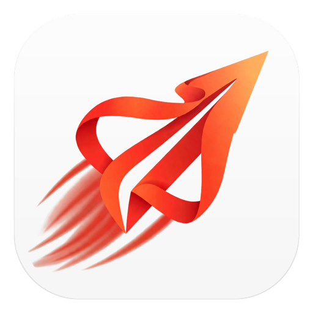

<p align="center">
  
</p>

<h1 align="center">GoRequest</h1>

<p align="center">
  <strong>本地优先、Git 原生的 API 开发与文档工作台</strong>
</p>

<p align="center">
  在原生桌面应用里调试 HTTP、管理环境与密钥、编写接口文档、运行自动化测试和本地 Mock。<br />
  请求、环境与文档都以纯文本保存在你的 Git 仓库中。
</p>

<p align="center">
  <a href="#下载">下载</a> ·
  <a href="#核心功能">功能</a> ·
  <a href="#反馈与贡献">反馈</a>
</p>

<p align="center">
  <a href="https://github.com/Flyinsky2004/GoRequest"></a>
  
  
  
  
</p>

---

## 为什么选择 GoRequest

- **本地优先**：无需登录账号，编辑、调试、文档和 Mock 都在本机完成。
- **Git 原生**：每个请求是独立 YAML 文件，项目资料放在 `.gorequest/`，可以随业务代码一起审阅、提交和合并。
- **原生桌面**：Go + MyGo Native UI 直接绘制界面，不使用 WebView。
- **密钥更安全**：支持 `{{secret.name}}` 引用，真实密钥保留在本机系统凭据、用户主动选择的本地文件或环境变量中，避免随项目提交。
- **多项目并行**：每个项目独立窗口，标签、未保存编辑、环境和响应互不干扰。

## 核心功能

### 请求调试

- 常用与自定义 HTTP 方法，有序 Query / Headers，结构化编辑与自动补全
- JSON、Text、XML、form-urlencoded、multipart、Binary 与项目内文件
- 变量解析、URL 预览、发送与取消、请求级超时，以及 WebSocket 手工会话

### 环境、鉴权与密钥

- 项目 → 环境 → 集合 → 请求的分层变量
- None / Bearer / Basic / API Key，以及 OAuth 2.0 与 OIDC
- 支持 `{{secret.name}}` 引用，真实密钥保留在本机系统凭据、用户主动选择的本地文件或环境变量中，避免随项目提交；默认使用系统 Keychain，可显式切换到 `~/.gorequest/secrets` 下按项目/克隆隔离的本地文件（明文，UI 会如实标识），切换会先列出计划、复制并逐项读回校验；生产环境变更需显式确认

### 网络与响应

- HTTP / SOCKS5 代理、重定向策略、阶段超时
- 自定义 CA、mTLS、隔离的 Cookie Jar
- Pretty / Raw / JSON 树，Headers、Cookie、网络阶段信息与二进制保存

### 接口文档

- Markdown 源码、原生预览与分栏
- 原生画布编辑、GFM 表格、`@` 接口引用
- 大纲、项目内全文搜索、本地图片与附件，离线 Markdown / HTML 导出

### 测试、Mock 与性能

- 集合 / Suite Runner，断言与提取，JSON / JUnit 报告导出
- 本地 Mock 规则、场景与访问记录
- 性能诊断：阶段耗时、分位数与 JSON / CSV 导出

### 互操作与 Git

- OpenAPI 3.1 / 3.2 导入导出与 JSON Schema 校验
- cURL、Postman Collection / Environment 导入导出，原生便携包与五种语言 Snippet
- Git 状态、Diff、选择性提交、Pull / Push；外部修改刷新与冲突保护
- 脱敏的本地请求历史与恢复

原生桌面体验：多项目窗口、标签页、简体中文 / English、浅色 / 深色主题、自动保存与快捷键。

> **开发状态**：GoRequest 仍在持续开发中。以上是当前代码中已具备的能力；完整范围与未完成项见 [实现状态](docs/implementation-status.md) 与 [开发路线图](docs/roadmap.md)。

## 下载

安装包通过 GitHub [Releases](https://github.com/Flyinsky2004/GoRequest/releases) 分发。发布工作流为以下目标构建产物：

| 平台 | 架构 | 产物 |
| --- | --- | --- |
| macOS 12+ | Apple Silicon / Intel | 含 `GoRequest.app` 的 `.dmg` |
| Windows | x64 / ARM64 | `.exe` 安装器、`.zip` 便携版 |

macOS 使用 ad-hoc 签名，Windows 未配置代码签名，首次打开时系统可能提示来源验证。实际可用版本与附件以 Releases 页面为准；如果尚无可用附件，可以按下面的方式从源码运行。目前不提供 Linux 发行包。

<details>
<summary>从源码体验</summary>

需要 **Go 1.27.3 或更高版本**。

```bash
git clone https://github.com/Flyinsky2004/GoRequest.git
cd GoRequest

# 直接运行桌面应用并打开示例项目
go run ./cmd/gorequest-desktop -project examples/sample-project
```

可选：启动本地演示服务，配合桌面应用手动联调。

```bash
go run ./examples/demo-server -addr 127.0.0.1:4010
```

构建独立二进制：

```bash
go build -o bin/gorequest-desktop ./cmd/gorequest-desktop
./bin/gorequest-desktop -project examples/sample-project
```

</details>

## 反馈与贡献

- 问题与建议：提交 [GitHub Issue](https://github.com/Flyinsky2004/GoRequest/issues)
- 代码与文档改进：欢迎 Pull Request
- 请勿在 Issue、PR 或示例项目中粘贴真实密钥或凭据

## 许可证

GoRequest 以 [GNU Affero General Public License v3.0](LICENSE)（AGPL-3.0）发布。

## 开发资料

[实现状态](docs/implementation-status.md) · [产品需求](docs/product-requirements.md) · [技术架构](docs/architecture.md) · [存储格式](docs/storage-format.md) · [开发路线图](docs/roadmap.md) · [设计决策](docs/decisions.md)
