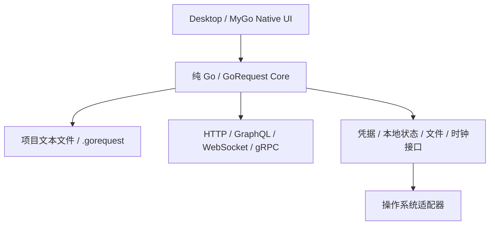

# 技术架构

状态：架构方向已确定；模块名称、接口形状和目录是设计草案，尚无代码实现。

## 1. 分层与依赖



图表源码即为设计资料；不表示 GoRequest 已具备 Mermaid 渲染。依赖方向由外向内：Core 不得导入 MyGo、桌面窗口、原生 UI、浏览器 IPC 或 GUI 事件类型。GoRequest 只有桌面一个前端，不提供独立产品 CLI。

Core 为纯 Go 业务与执行层，系统凭据、文件监视、浏览器启动等通过小接口注入。协议适配器也使用 Go；Desktop 可使用 MyGo 的系统集成能力，但 Core 本身不得依赖它。

MyGo 官方区分 Native UI 与网页窗口；本项目仅选择 Native UI 作为主界面，不能因框架也支持网页窗口而改变路线。[MyGo Native UI 官方说明](https://mygo.egoist.dev/docs/ui)

## 2. 模块职责

| 模块 | 主要职责 |
| --- | --- |
| Workspace / Project | 打开目录、定位 `.gorequest/`、全局/项目切换、稳定 ID 索引 |
| File Store | YAML/Markdown/JSON/Proto/SDL 读取、引用、原子保存、外部变更与迁移 |
| Model / Validator | 统一请求/环境/套件/结果模型，结构、引用和语义校验 |
| Variable Resolver | 变量层级、显式命名空间、模板编码、动态值、来源与敏感标记 |
| Auth Manager | 鉴权继承、Token 生命周期、刷新并发控制、凭据引用 |
| Execution Engine | 构建不可变执行计划、超时、取消、依赖调度、重试、结果事件 |
| Protocol Adapters | HTTP、GraphQL、WebSocket、gRPC 的传输与协议事实 |
| Test Runner | 断言、提取、数据驱动、流式脚本、聚合与失败分类 |
| Trace / Metrics | 网络事件、逐跳耗时、采样、分位数与比较 |
| Import / Export | cURL/Postman/OpenAPI 转换、差异预览、损失报告 |
| Mock Engine | 匹配规则、场景、模板、监听和与套件联动 |
| Documentation / Diagram | 文档引用、派生参数表、离线图表适配与导出 |
| Generators / Reports | 调用代码、规范驱动生成、JSON/JUnit/HTML 报告 |
| Local Services | 凭据、个人历史、Cookie、缓存、设备配置；全部与 Git 项目分离 |

模块以接口隔离协议、断言、报告、导出器、生成器。首版不引入可下载任意插件或自动执行外部脚本的机制。

## 3. 共享模型与请求生命周期

请求定义、解析后的执行计划、网络结果、测试判定为不同对象：共享文件不因运行结果被改写；可视化编辑不把设备状态写回项目。

1. 加载项目快照，记录格式版本、文件内容摘要和来源位置。
2. 校验唯一 ID、引用、依赖环、协议参数、环境和目标策略。
3. 解析变量/鉴权，得到带敏感标记的不可变计划；未定义值在发网前报错。
4. 创建运行上下文与取消信号，隔离每个数据行、并发分支和 Cookie 会话。
5. 协议适配器发出连接/消息/响应/Trace 事件，采用有界缓冲与背压。
6. 执行断言、提取、依赖步骤和统计，区分配置错误、请求失败与内部故障。
7. 先脱敏再输出事件、历史、UI、日志及报告；关闭连接和临时 Mock。

桌面视图通过同一个 Core 入口调用执行（概念形状为 `Run(context, plan, eventSink)`），UI 不直接执行网络请求。界面中未保存的请求可以通过内存快照发送，但需标识；当比较“已保存快照”与“内存编辑”时，必须使用相同的已保存快照及 Core 版本。

## 4. 执行与并发约束

- 所有长任务接受取消信号和 Deadline：DNS/连接、Token 获取、流式接收、Mock、导出和生成都可结束。
- Runner 首先构建有向无环图；只有声明依赖的后继可以读取上游输出。
- 每次运行、每个数据行与并发分支独立保存可变状态；项目文件与全局变量不作为运行共享内存。
- 事件需有 run/step/attempt/message ID 和单调顺序号；UI 批量消费，不能阻塞 Core。
- 读取大响应/消息流有磁盘暂存、体积及条数上限；“暂停查看”只暂停展示，不隐含无限缓存。
- 重试保留全部尝试；非幂等请求只有显式策略才允许自动重试，取消不触发重试。

## 5. 文件与状态边界

项目文本是事实来源；索引和数据库只能是可重建缓存。全局个人请求可采用相同文本模型，但位于应用数据目录，向项目复制时必须预览并去除凭据、Cookie 与机器路径。

保存采用内容摘要比较、同目录临时文件、原子替换和失败恢复；外部修改与内存未保存编辑之间进入显式冲突流程。多个文件的导入/迁移先生成完整变更集并校验，确认后应用；失败可恢复，不能混用半迁移版本。

## 6. 平台与工程组织草案

```text
cmd/gorequest-desktop/  # MyGo Native UI 入口（唯一产品入口）
internal/core/         # 模型、变量、执行、测试、文档等共享能力
internal/protocol/     # 各协议适配器
internal/platform/     # 凭据、目录、文件监视、系统集成适配
internal/desktop/      # 视图与交互状态
```

Desktop 平台目标为 macOS、Windows、Linux，具体最低系统版本、CPU/GPU 与打包依赖通过原生 UI 验证后确定。Core 不依赖桌面运行时，便于单元测试与后续复用，但不作为独立命令行产品发布。

## 7. 实现前的技术验证

MyGo 的编辑器、Markdown、Diff、Tree、分栏、多标签、输入法、可访问性和大列表需以项目场景验证，不能由“框架有组件”推导为“产品已可用”。Mermaid、Schema 校验库、Git 适配、凭据后端、文本格式保真与完整版本兼容性见[待决策清单](decisions.md)。
